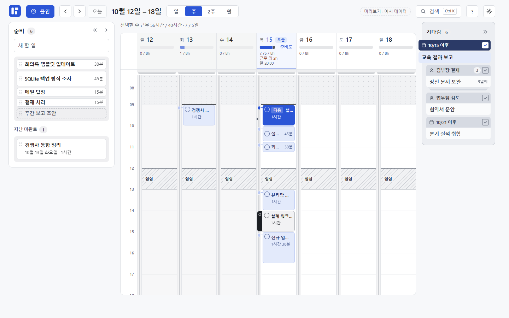
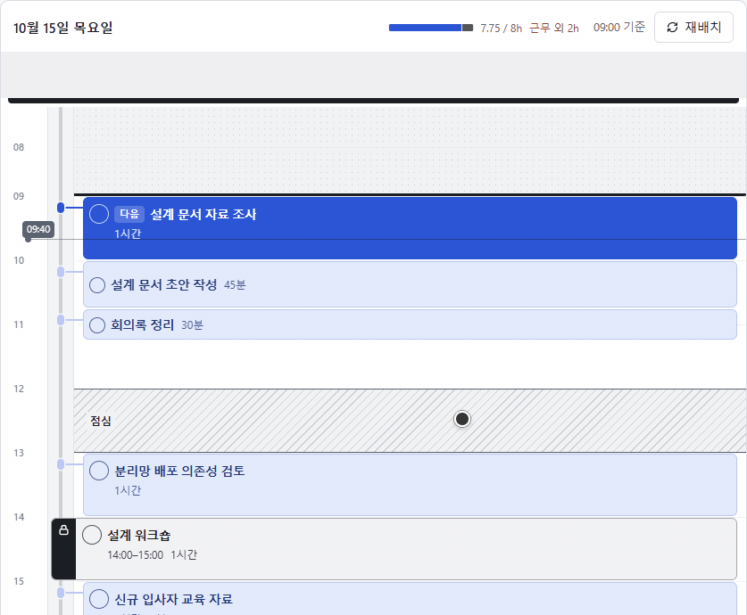
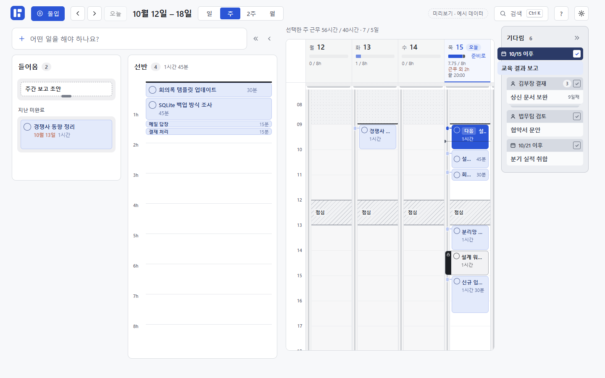
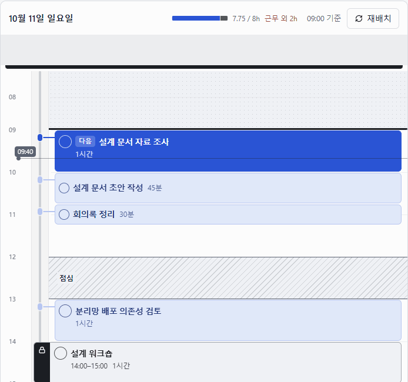
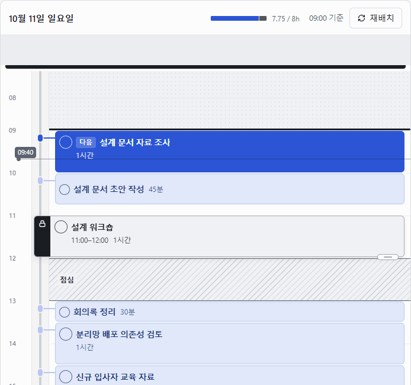
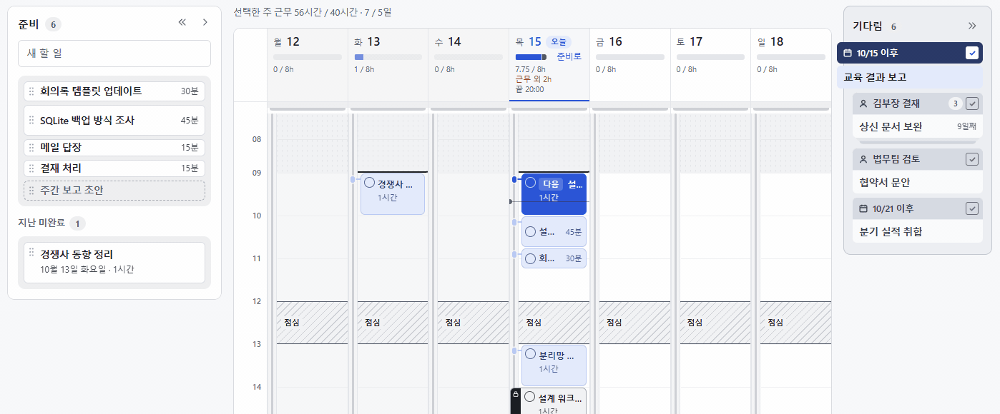
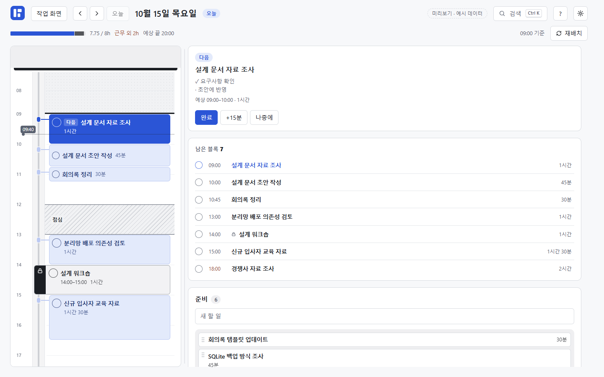

# BLOKKY

**할 일을 블록으로 만들어 시간표에 싣고, 끝낸 만큼 남은 일정을 정리하는 Windows용 오프라인 앱.**

시간표를 계속 고치는 부담을 줄이기 위해 만들었습니다. 들어온 일을 먼저 **길이를 가진 블록**으로 만들고, **날짜와 순서**만 정해 시간표에 실으면 빈 시간에 차례로 놓입니다. 회의처럼 시작 시각을 지켜야 하는 일만 따로 고정합니다.

- **블록으로 조작** — 시간축에서 블록의 높이가 곧 배분한 시간입니다. 끌어서 순서를 바꾸고, 아래 경계를 늘려 시간을 조절하고, 레일에 걸어 시각을 고정합니다.
- **완료하면 재배치** — 오늘의 일반 업무를 완료하면, 남은 일이 고정 일정을 피해 현재 시각부터 다시 놓입니다.
- **한 화면에서 가공과 배분** — 왼쪽 **준비** 도크에서 들어온 일을 블록으로 만들고, 옆 캘린더의 날짜에 바로 싣습니다.
- **몰입** — 오늘 할 일만 띄워 ‘다음’ 블록을 완료·연장·미루기로 바로 처리합니다.
- **기다림** — 내 차례가 아닌 일은 트리거(‘김부장 결재’, ‘10/20’)를 달아 오른쪽 띠로 밀어 두고, 트리거가 충족되면 블록으로 되살립니다.

로그인이나 네트워크 연결 없이 사용하며, 기록은 내 PC에 저장합니다. [최신 설치 파일 받기](https://github.com/rfastball/Time_Blocking_Manager/releases/latest)



*작업 화면 — 왼쪽 준비 도크, 가운데 캘린더, 오른쪽 기다림 띠. 모든 화면과 GIF는 브라우저 미리보기의 예시 데이터로 촬영했습니다.*

[작동 방식](#작동-방식) · [직접 조작 데모](#직접-조작-데모) · [사용법](#사용법) · [기록과 복구](#기록과-복구) · [기술 스택](#기술-스택) · [개발 내용](#개발-내용) · [실행·빌드](#개발-환경)

## 작동 방식

### 블록의 길이는 작업에 배분한 시간

블록 하나는 작업 하나입니다. 60분 블록은 그 작업에 60분을 배분했다는 뜻이며, 실제로 일한 시간이나 진행률을 뜻하지 않습니다.

| 상태 | 사용자가 정하는 것 | 동작 |
| --- | --- | --- |
| **준비** | 할 일과 배분할 시간(나중에 정해도 됨) | 날짜를 정하기 전까지 들어옴이나 선반에 보관 |
| **기다림** | 기다리는 상대·일 또는 날짜 | 트리거를 달고 오른쪽 띠에 보관. 충족은 사람이 확인 |
| **유동계획** | 날짜·순서·배분할 시간 | 시작 시각을 고정하지 않고, 휴식과 고정 작업을 피해 배치 |
| **고정계획** | 날짜·시작 시각·배분할 시간 | 다른 작업이 움직여도 지정한 시각을 유지 |

유동 작업은 정해 둔 순서를 지키며, 한 블록을 여러 시간대로 자동 분할하지 않습니다. 예를 들어 60분 작업은 30분짜리 빈 시간 두 곳에 나눠 넣지 않습니다. 근무시간 안에 들어가지 못한 작업부터는 순서대로 근무 종료 뒤에 놓고, 점선과 **근무 외 시간**으로 표시합니다.

### 끝낸 일은 빼고, 남은 일은 지금부터

오늘의 유동 작업을 완료하거나 **재배치**를 누르면, 남은 유동 작업이 현재 시각부터 다시 놓입니다. 각 작업에 배분한 시간과 순서는 유지합니다. 고정 작업은 완료해도 지정한 시간대를 차지합니다.



*09:40에 첫 작업을 완료하면 다음 작업이 09:40부터 놓이고, 오후의 ‘분리망 배포 의존성 검토’가 점심 전으로 당겨집니다. 고정한 ‘설계 워크숍’은 14:00에 그대로입니다. [정지 화면](assets/readme/completion.png)*

**시간이 흐르는 것만으로는 아무것도 바뀌지 않습니다.** 자동 완료·지연 표시·남은 시간·자동 재배치·자동 이월이 없고, ‘다음’은 시계와 무관하게 남은 첫 유동 블록입니다. 타이머를 켜고 끄거나 실제 수행시간을 입력할 필요도 없습니다.

### 두 화면

| 화면 | 하는 일 |
| --- | --- |
| **작업 화면** | 앱이 시작하는 곳. 왼쪽 **준비** 도크에서 블록을 만들고, 가운데 **일·주·2주·월** 캘린더에 배분하며, 오른쪽 **기다림** 띠에 기다리는 일을 둡니다. |
| **몰입** | 오늘을 하는 곳. 오늘의 시간표, ‘다음’ 카드, 남은 블록, 준비를 보며 차례로 완료합니다. |

위 막대의 **몰입**·**작업 화면** 버튼이나 `F`로 오갑니다. 설정은 톱니, 검색은 `Ctrl+K`로 엽니다. 어느 화면에서든 블록을 누르면 그 옆에 제목·메모 편집기가 열립니다.

준비 도크는 **좁게·넓게·접힘** 세 폭이며, 사용자가 도크의 버튼이나 `[`·`]`로 바꿀 때만 바뀌고 기억됩니다. 좁은 도크는 캘린더에 끌어 놓을 목록이고, 넓은 도크는 블록의 길이를 정하고 쪼개고 합치는 작업대입니다. **길이를 정하는 것과 자리를 옮기는 것은 별개의 동작**입니다.



*넓은 준비 도크 — 들어옴과 선반 옆에 캘린더가 그대로 보입니다.*

설계의 배경은 [유동형 업무 배분 재설계안](docs/BLOKKY_redesign_intent_and_ux.md), 현재 정책은 [제품 정의](PRODUCT.md)와 [구현 결정](docs/decisions.md)에 기록합니다.

## 직접 조작 데모

### 끌어서 순서를, 경계를 늘려 시간을


*‘회의록 정리’를 맨 앞으로 옮긴 뒤, 아래 경계를 끌어 30분에서 1시간으로 늘립니다. 블록은 잡은 지점이 늘 포인터 아래에 있도록 지연 없이 따라옵니다. [정지 화면](assets/readme/block-motion.png)*

### 레일에 걸면 시각 고정, 떼면 다시 순서로

**고정 레일**은 시간 눈금 옆의 세로 막대입니다. 블록을 레일 쪽으로 밀면 걸쇠가 나타나고 시작 시각이 15분 단위로 고정됩니다. 레일을 따라 위아래로 옮기면 고정 시각이 바뀌고, 오른쪽 작업 영역으로 떼어 내면 유동 작업으로 돌아옵니다. 주변 유동 작업은 고정된 시간대를 피해 다시 놓입니다.



*11시에 고정 → 10시로 이동 → 고정 해제. 위아래로 옮길 때의 작은 좌우 흔들림으로는 고정되지 않도록 조작을 구분합니다. [정지 화면](assets/readme/rail-latch.png)*

### 경계에서 멈추고, 더 밀면 겹친 부분만 표시

고정 블록을 끌어 점심이나 근무 종료 경계를 넘기려 하면 경계에서 한 번 멈춥니다. 더 밀면 이동을 허용하고, 근무·휴식 설정상 일할 수 없는 구간과 겹친 부분만 빗금으로 표시합니다.



*11:00–12:00 작업을 밀면 경계에서 한 번 멈추고, 더 밀어 11:15–12:15로 옮기면 점심과 겹친 15분에만 빗금이 생깁니다. [정지 화면](assets/readme/boundary-response.png)*

### 기다림 띠로 밀고, 꼬리표를 떼어 되살리기

블록을 오른쪽 **기다림** 띠에 끌어 놓으면 그 자리에서 트리거를 묻습니다. 같은 트리거의 블록은 한 꼬리표 아래 묶음으로 쌓이고, 꼬리표의 네모 손잡이를 누르면 꼬리표가 떨어지며 블록이 선반 맨 위로 돌아옵니다.



*‘회의록 정리’를 띠로 밀어 ‘디자인팀 회신’을 달고, 네모 손잡이로 충족해 선반 맨 위로 되살립니다. 밀기와 충족 직후에는 몇 초 동안 ‘되돌리기’가 뜹니다. [정지 화면](assets/readme/wait.png)*

## 사용법

### 1. 생각나는 일을 담기

준비 도크의 입력란에 제목을 쓰고 `Enter`를 누르면 **들어옴** 맨 위에 담깁니다. 담기만 한 작업은 두께가 없는 점선 테두리의 **판**으로 남습니다. 몰입 화면에서는 `A`로 담기 칸에 갑니다.

다른 앱에서 일하는 중에는 `Ctrl+Shift+Space`로 **빠른 캡처** 창을 엽니다. `Enter`로 저장하고, `Shift+Enter`로 줄을 바꾸며, `Esc`로 초안을 보존한 채 숨깁니다. 단축키는 설정에서 변경할 수 있습니다.

### 2. 준비에서 블록 만들기

준비 도크를 넓히면(`]`) **들어옴**과 **선반**이 나란히 펼쳐집니다. 블록의 높이는 캘린더와 같은 축척의 소요시간입니다.

- **들어옴** — 아직 자리를 정하지 않은 일입니다. 새로 담은 판, 길이만 정한 블록, 그 아래 원래 날짜가 표시된 **지난 미완료**가 있습니다.
- **선반** — 보관하기로 한 블록의 순서입니다. 검은 천장에서 위→아래로 이어 매달리며, 이 순서가 좁은 도크와 몰입의 준비 목록 순서가 됩니다.

판 아래 손잡이를 끌어 내리거나 `↓`를 눌러 길이를 정하면 그 자리에서 블록이 됩니다. 판인 채로 선반이나 날짜에 놓으면 30분으로 정해집니다. 들어옴과 선반 사이는 끌어 놓거나 `Alt+→`(선반 끝으로)·`Alt+←`(들어옴 맨 위로)로 옮깁니다.

블록을 `Ctrl`·`Shift`+클릭으로 고르면 아래 막대에서 선반으로·오늘에 싣기·다른 날·하나로 합치기·완료·삭제를 한꺼번에 합니다. 선반의 검은 천장을 누르면 선반 블록을 모두 고르고, 끌면 선반 전체를 순서대로 옮깁니다. 준비에서 완료한 일은 들어옴 아래 **방금 완료**에 남아 원래 자리로 되돌릴 수 있습니다.

블록 메뉴(우클릭·`Shift+F10`)의 **나누기**를 누르면 **도마**가 열립니다.

- 칼선으로 15분 단위로 자르고, 조각 사이 이음매를 끌어 시간을 주고받으며, 이음매를 두 번 눌러 다시 잇습니다.
- 조각 이름을 입력해 추가하거나, 메모의 체크리스트로 조각을 한 번에 만듭니다.
- 닫으면 각 조각이 원래 자리부터 연달아 놓이는 독립 작업이 됩니다. **취소**는 이번 편집을 버립니다.

캘린더 블록을 나누면 조각이 그날 순서에 연달아 놓이고, 고정 블록이면 원래 시작 시각부터 이어서 고정됩니다.

### 3. 날짜에 배분하기

준비의 블록을 캘린더의 날짜에 끌어 놓습니다. 작업 영역에 놓으면 그날의 유동 작업이 되고, 시간 눈금 옆 **고정 레일**에 놓으면 그 시각에 고정됩니다. 날짜 머리에 놓으면 그날 순서 끝에 실리며, 놓기 전에 놓일 자리와 근무 외로 넘치는 분량을 실제 크기로 보여 줍니다.

| 보기 | 키 | 용도 |
| --- | --- | --- |
| **일** | `D` | 하루를 넓게 펼쳐 블록을 만들고 배치 |
| **주** | `W` | 여러 날짜의 시간표를 함께 보고 작업 이동 |
| **2주** | `2` | 날짜별 작업 제목을 보고 선택 날짜의 시간표 확인 |
| **월** | `M` | 날짜별 작업량을 보고 선택 날짜의 시간표 확인 |

날짜 제목을 누르면 그날의 **일** 보기로 갑니다. 일·주 시간표의 빈 곳을 클릭하면 그날 순서 끝에 30분 유동 블록을 만들고, 시간 범위를 드래그하면 그 시각과 길이의 고정 블록을 만듭니다.

블록 하단 손잡이로 길이를 바꿉니다. 블록 메뉴에는 시각 고정·고정 해제·나누기·준비로 보내기·완료·삭제처럼 그 자리에서 바로 할 수 없는 일만 있으며, 삭제한 작업은 휴지통으로 옮깁니다. 넓은 도크가 열려 있으면 캘린더 블록을 들어옴·선반의 원하는 자리에 끌어 놓아 날짜를 풀 수도 있습니다.

근무 외로 넘친 유동 블록이 있는 날은 날짜 머리에 **준비로**가 붙습니다. 누르면 넘친 블록들이 그날 순서 그대로 선반 맨 위로 갑니다. 오늘 머리에는 남은 계획이 끝나는 시각을 보여 줍니다.

### 4. 몰입에서 오늘을 끝내기



**몰입**은 오늘의 시간표, **다음** 카드, 남은 블록 목록, 준비를 보여 줍니다. ‘다음’ 카드에서 바로 처리합니다.

- **완료** — 남은 유동 작업이 현재 시각부터 다시 놓이고, 키보드 포커스는 새 ‘다음’의 완료로 갑니다.
- **+15분** — 배분한 시간을 15분 늘립니다.
- **나중에** — 선반 맨 위로 보냅니다.

완료한 작업 없이 현재 시각부터 다시 배치하려면 **재배치**를 누릅니다. 오늘 남은 블록이 없으면 배분 막대 옆에 ‘오늘 끝 · 완료 N’을 보여 줍니다.

모든 완료에는 날짜가 있습니다. 준비의 작업을 완료하면 오늘의 완료로 기록하며 시간표를 다시 배치하지 않습니다. 지난 날짜의 미완료 작업은 준비의 **지난 미완료**에 모이며, 직접 다른 날짜나 선반으로 옮깁니다. 자동으로 다음 날에 이월하지 않습니다.

### 5. 기다리는 일을 밀어 두기

결재·회신처럼 내 차례가 아닌 일은 **기다림** 띠로 밉니다.

- **밀기** — 블록을 띠에 끌어 놓거나, 블록에 포커스를 두고 `B`를 누릅니다. 몰입에서는 ‘다음’ 카드에서 `B`. 고정 블록은 시각이 풀립니다.
- **트리거** — 상대와 할 일(‘김부장 결재’)이나 날짜(‘10/20’, ‘내일’, ‘모레’)를 씁니다. 이미 쓰고 있는 트리거와 내일·다음 주 월요일을 고를 수 있고, `Esc`는 정하지 않은 채로 둡니다.
- **기다리는 동안** — 같은 트리거의 블록은 한 꼬리표 아래 쌓이고, 누르면 펼쳐집니다. 날짜가 된 트리거는 꼬리표가 진해질 뿐 저장 상태는 그대로이며, 7일 이상 기다린 상대 트리거에는 ‘N일째’가 붙습니다.
- **충족** — 꼬리표의 네모 손잡이나 `B`. 블록이 선반 맨 위(판은 들어옴 맨 위)로 돌아오고, 그 자리에서 다음 행동으로 제목을 고칠 수 있습니다. 띠의 블록을 날짜에 바로 끌어 놓아도 됩니다.

꼬리표 글자를 누르거나 `F2`로 트리거를 고칩니다. 띠는 탭 한 번으로 들어가 `↑`/`↓`로 걷고, 글자 키는 초성으로 건너뜁니다. 띠는 `\`나 띠의 버튼으로 접고 펴며, 몰입 화면에는 띠가 없습니다.

### 6. 작업 찾기

위 막대의 **검색** 또는 `Ctrl+K`로 검색창을 엽니다. 준비·기다림·모든 날짜·완료·휴지통의 제목과 메모를 부분 일치로 찾고, 결과마다 지금 있는 위치를 보여 줍니다. `↑`/`↓`로 고르고 `Enter`를 누르면 그 작업이 있는 곳으로 이동해 강조합니다. 한글을 조합하는 중에도 결과가 갱신됩니다.

### 7. 근무 리듬과 반복 업무 맞추기

- **설정 → 한 주의 근무 리듬**에서 요일별 근무·휴식과 주간 목표를 정합니다. 기본 목표는 40시간·5일이며, 실제 근태가 아닌 예정 근무량입니다.
- 시간표의 근무 외 시간이나 휴식을 클릭하면 그 날짜만의 출퇴근·점심·휴가 예외를 설정할 수 있습니다. 고정 작업과 충돌하는 변경은 영향 작업을 확인하고 동의한 뒤 저장합니다.
- **설정 → 정기 업무**에 요일·시작 시각·작업 시간을 등록하면 오늘을 포함한 이후 날짜 중 화면에 표시된 날짜에 작업을 만듭니다. 근무·휴식 설정이나 다른 고정 작업과 겹치면 같은 날짜의 유동 작업으로 만듭니다. 정기 업무를 수정·삭제해도 이미 생성한 작업은 바뀌지 않습니다.
- **테마**는 기본·종이 플래너·톤 레이어·사무 장부의 2×2 미리보기에서 선택합니다.

<details>
<summary>단축키와 앱 종료</summary>

`?`나 위 막대의 `?` 버튼으로 단축키 목록을 엽니다. 한 글자 단축키는 키의 물리 위치로 판정해 한글 자판에서도 같게 동작하며, 입력란에 있거나 한글을 조합하는 중에는 받지 않습니다. 목록 맨 아래 **한 글자 단축키** 스위치로 끌 수 있습니다.

| 조작 | 동작 |
| --- | --- |
| `Ctrl+Shift+Space` | 빠른 캡처 열기 — 기본 단축키 |
| `Ctrl+K` | 검색 |
| `F` | 몰입 ↔ 작업 화면 |
| `T` | 오늘로 |
| `D` · `W` · `2` · `M` | 일 · 주 · 2주 · 월 |
| `[` · `]` | 준비 접기·펴기 · 넓히기·좁히기 |
| `\` | 기다림 접기·펴기 |
| `B` | 기다림으로 밀기 · 기다림에서 충족 |
| `A` | 몰입에서 담기 칸으로 |
| `Esc` | 몰입·설정에서 작업 화면으로 |
| 블록·카드에서 `↑` / `↓` | 배분한 시간을 15분 단위로 조절 |
| 블록에서 `Alt+↑` / `Alt+↓` | 같은 곳 안에서 순서 변경 |
| 준비 카드에서 `Alt+→` / `Alt+←` | 선반 끝으로 / 들어옴 맨 위로 |
| `Shift+F10` | 포커스한 블록의 메뉴 열기 |
| `Delete` | 휴지통으로 이동 |

창의 `X`를 누르면 기본적으로 앱은 계속 실행되고 창만 숨겨집니다. Windows 알림 영역(트레이)의 BLOKKY 메뉴에서 **종료**를 선택하면 앱이 종료됩니다. 설정에서 창을 닫을 때 바로 종료하도록 바꿀 수도 있습니다.

종료 전에 본 창과 캡처 창의 입력을 자동 저장합니다. 저장에 실패하면 오류를 표시하고 앱을 계속 열어 둡니다. Windows 자동실행은 설정에서 직접 켭니다.

</details>

## 기록과 복구

업무 기록은 로컬 SQLite에 저장합니다. 기본 위치는 `%LOCALAPPDATA%\com.blokky.desktop` 폴더의 `blokky.sqlite`이며, 실제 경로는 앱 설정에서 확인할 수 있습니다.

| 보호 장치 | 동작 |
| --- | --- |
| **초안** | 입력 중인 내용을 별도로 보존하고, 닫을 때 저장·초안으로 남기기·변경 버리기 중에서 고르며, 복원된 편집은 ‘이어서 편집’으로 열기 |
| **휴지통** | 삭제한 작업을 30일간 보관하고 원래 날짜·순서·완료 상태로 복원. 넓은 준비 도크의 들어옴 아래에 접혀 있음 |
| **되돌리기** | 기다림으로 밀기와 충족 직후 몇 초 동안 원래 자리로 되돌리기 |
| **자동 백업** | 시간별 24개, 날짜별 30개를 보존 |
| **지금 백업** | 앱 데이터 폴더의 `backups`에 수동 백업 생성 |
| **복원 전 보호** | 미저장 입력을 먼저 정리하고, 현재 기록 교체 확인 및 안전 백업 후 복원 |

휴지통에서 복원할 고정 작업의 시각이 다른 고정 작업이나 근무·휴식 설정과 겹치면, 같은 날짜의 유동 작업으로 복원합니다. 개별 영구 삭제와 휴지통 비우기도 제공합니다.

이전 버전에서 날짜 없이 완료한 기록은 들어옴 아래 접힌 **날짜 없는 완료** 목록에 남습니다. 항목마다 선반으로 되돌리거나 삭제할 수 있고, **보관 목록 비우기**로 한꺼번에 휴지통으로 옮깁니다.

백업은 **설정 → 백업·복원**의 앱 내부 목록에서 검사하고 복원합니다. 손상된 백업은 오류 이유와 함께 비활성화하며, 현재 DB가 열리지 않아도 보관된 백업으로 복구를 시도할 수 있습니다. 수동 백업과 복원 전 안전 백업은 자동 정리 대상에서 제외합니다.

SQLite 백업에는 작업·준비 순서·기다림·휴지통·근무 설정·정기 업무·정기 업무의 날짜별 생성 이력이 들어갑니다. 테마·빠른 캡처 단축키·자동실행·창 닫기 옵션·도크와 띠의 폭·한 글자 단축키 설정은 기기 설정이므로 백업 복원으로 바뀌지 않습니다.

파일 탐색기로 임의 백업을 가져오거나 외부 경로로 내보내는 기능은 없습니다. 백업도 앱 데이터와 같은 디스크에 저장되므로 디스크 고장에 대비하는 별도 사본을 대신하지는 못합니다.

## 기술 스택

| 계층 | 기술 | 맡은 역할 |
| --- | --- | --- |
| 화면 | **React 19 · TypeScript · Vite 7** | 작업 화면·몰입·준비 도크·기다림·도마·검색·설정과 브라우저 미리보기 |
| 직접 조작 | **@dnd-kit/core · motion** | 드래그 감지, 형태 전환과 착지·완료 동작 |
| 디자인 | **CSS 역할 토큰 · 로컬 글꼴** | 네 가지 테마와 공통 색·간격·크기 규칙 |
| 데스크톱 | **Tauri 2 · Rust · WebView2** | Windows 창, 전역 단축키, 트레이, 자동실행 |
| 저장 | **SQLite · rusqlite** | 트랜잭션, 초안, 이관, 백업·복구 |
| 검증 | **Node test runner · Rust tests · 헤드리스 Edge** | 순수 로직, 실제 파일 저장소, 명시적 UI 시나리오 |

React 화면의 변경 요청을 Tauri IPC로 전달하면 Rust가 검증해 SQLite에 기록합니다. SQLite는 WAL·FULL synchronous로 동작합니다. 항목 버전(revision)을 검사해 오래된 편집이 최신 기록을 덮어쓰지 못하게 하고, 같은 요청의 중복 처리를 막습니다. 이미 저장된 요청은 처리 기록을 먼저 확인해 완료 처리하며, 입력을 수정해도 결과가 확정되지 않은 이전 요청은 별도로 보존합니다. 처리 기록은 30일 보관하며, 기록이 없는 오래된 요청은 입력을 유지하고 저장 여부를 확인하도록 합니다. 확인할 수 없는 요청을 새 저장으로 바꾸려면 중복 가능성을 확인해야 합니다. 백업 복원 전의 요청도 복원 후 기록에 적용하지 않습니다. 로그에는 제목·메모를 남기지 않습니다.

## 개발 내용

- **로컬 업무 흐름** — 빠른 캡처부터 준비·정기 업무·근무시간·날짜 예외까지 연결했습니다. [제품 정의](PRODUCT.md)
- **유동형 배분** — 날짜·순서 중심 계획, 고정 일정 우회, 완료·수동 재배치와 근무 외 넘침 표시를 구현했습니다. [재설계안](docs/BLOKKY_redesign_intent_and_ux.md) · [구현 계획](docs/BLOKKY_redesign_implementation_plan.md)
- **React 화면 전환** — 공통 블록 공간과 편집기를 만들고, 일·주·2주·월 캘린더를 구성했습니다. [React 도입 계획](docs/BLOKKY_react_migration_plan.md)
- **준비와 도마** — 자유 캔버스를 들어옴·시간 축척 선반으로 바꾸고, 길이와 자리를 따로 정하게 했으며, 도마로 작업을 쪼개고 모든 작업을 한 검색창에서 찾도록 했습니다. [제품 정의](PRODUCT.md) · [구현 결정](docs/decisions.md)
- **한 화면과 몰입** — 오늘·계획·준비 탭을 작업 화면(준비 도크 + 캘린더)과 몰입 두 화면으로 합치고, 도크 폭으로 가공과 배분을 나눴습니다. ‘다음’ 카드의 바로 처리, 넘침의 ‘준비로’, 블록 옆 편집기, 한 글자 단축키를 더했습니다. [한 화면 구현 계획](docs/one-screen-plan.md) · [구현 결정](docs/decisions.md)
- **기다림** — 내 차례가 아닌 일을 상태 버튼 대신 자리(오른쪽 띠)·꼬리표·쌓임으로 드러내고, 끌기·`B`·꼬리표 떼기로 밀고 되살립니다. [제품 정의](PRODUCT.md) · [구현 결정](docs/decisions.md)
- **직접 조작 개선** — 블록이 포인터를 따라오고 목적지의 형태를 따르되 지나가는 곳에서는 형태를 바꾸지 않도록 하고, 레일 맞물림·길이 조절과 이웃 블록의 이동을 다듬었습니다. [구현 결정](docs/decisions.md)
- **입력과 기록 보호** — 한글 조합 중 명령 방지, 초안 복원, 종료 전 저장, 휴지통, DB 이관·백업 복구를 구현했습니다. [검증 기록](docs/validation.md)
- **화면 품질** — 테마 토큰, 키보드 조작과 포커스 복귀, 좁은 창 배치, 날짜·작업의 글자 대비를 개선했습니다. [디자인 기준](DESIGN.md) · [검증 기록](docs/validation.md)

현재 저장소는 **스키마 10**입니다. v1–v3의 배치 작업은 고정 작업으로 읽고, v4에는 휴지통 정보를, v5까지의 기록에는 길이 미정 정보를 추가해 이관합니다. v8 이하의 날짜 없는 작업은 마지막 작업대 배치를 위→아래, 왼쪽→오른쪽으로 한 번 읽어, 길이를 정한 작업은 선반에, 판은 들어옴에 놓습니다. v10에서는 작업에 기다림 정보(기다리는 일·날짜·처음 민 날)를 더했습니다. 이관 직전에 안전 백업을 만들며, 새 스키마를 지원하지 않는 구버전 앱은 원본을 바꾸지 않고 접근을 거절합니다.

<details>
<summary>코드 구조</summary>

```text
src/
  app/
    shell/                   위 막대, 화면 전환, 단축키
    plan/                    작업 화면의 캘린더(일·주·2주·월)와 새 블록
    today/                   몰입 화면
    dock/ · inbox/           준비 도크와 넓은 도크의 작업대
    wait/                    기다림 띠
    space/                   공통 블록 공간과 드래그
    cut/ · search/           도마와 전역 검색
    editor/ · settings/      작업 편집·블록 메뉴와 설정
    store/                   앱 상태, 명령, 초안, 종료 흐름
    capture/ · backups/      빠른 캡처와 백업 화면
  flow.ts                    순서를 지키는 유동 배치 계산
  bench.ts · cut.ts          들어옴·선반 배치와 쪼개기 규칙
  waiting.ts                 기다림 트리거 해석과 묶음·순서
  search.ts                  검색 일치와 위치 표기
  shortcuts.ts               단축키 판정과 목록
  placement.ts · settings.ts  배치 검증과 근무 규칙
  tokens.css · theme.ts       역할 토큰과 테마
src-tauri/src/
  main.rs                    Windows 통합과 IPC
  db.rs · model.rs           SQLite 저장소와 데이터 규칙
scripts/                     실행·개발 서버·UI 확인 도구
docs/                        설계 결정과 검증 근거
```

</details>

## 개발 환경

설치 파일은 [Releases](https://github.com/rfastball/Time_Blocking_Manager/releases)에서 받을 수 있습니다. 소스에서 앱을 실행하거나 설치 파일을 만들려면 Windows에 **Node.js 22.12+**, Rust, MSVC C++ 빌드 도구, WebView2가 필요합니다.

### 데스크톱 앱 실행

저장소 루트의 PowerShell에서 실행합니다.

```powershell
npm ci
./scripts/run.ps1 dev
```

스크립트는 `.tools/cargo`의 로컬 Rust가 있으면 우선 사용하고, 없으면 시스템 환경을 사용합니다. 개발 서버는 1420부터 가용 포트를 선택해 Tauri에 전달합니다. 이전 개발 앱이 실행 중이면 트레이에서 종료한 뒤 다시 시작합니다.

### 화면만 미리 보기

의존성을 아직 설치하지 않았다면 먼저 `npm ci`를 실행합니다.

```powershell
npm run dev
```

터미널에 출력된 로컬 주소를 열면 예시 화면을 볼 수 있습니다. 브라우저에서 바꾼 내용은 **저장되지 않습니다**. 실제 저장·백업은 데스크톱 앱에서 확인합니다.

### 검증과 패키징

```powershell
./scripts/run.ps1 test -NoPause   # 프런트 로직 + Rust 저장소 테스트
npm run build                   # TypeScript 검사 + 프런트 배포 빌드
./scripts/run.ps1 package        # Windows NSIS 설치 파일 생성
```

UI 확인은 개발 서버 실행 후 별도로 수행합니다. `--base`에는 실제 출력된 주소를 지정합니다.

```powershell
node scripts/ui-check.mjs --base http://127.0.0.1:1420
```

이 검사는 헤드리스 Edge의 마우스·키보드 입력을 사용하며 기본 `npm test`에 포함되지 않습니다. 네이티브 디버그 앱은 `BLOKKY_TEST_DATA_DIR`로 시험 데이터 위치를 분리할 수 있습니다. 검증 계층과 비용 기준은 [테스트 정책](docs/test-policy.md)을 참고하세요.

생성된 설치 파일은 `src-tauri/target/release/bundle/nsis/`에 있습니다. WebView2 오프라인 설치기를 포함하며 코드 서명은 적용하지 않았습니다. WebView2가 이미 설치된 PC에서는 `src-tauri/target/release/blokky.exe`를 직접 실행할 수도 있습니다. 최신 변경을 포함하려면 소스를 갱신한 뒤 패키징 명령을 다시 실행하세요.

## 현재 범위와 검증 상태

버전은 **0.5.0**, 대상은 **Windows**입니다. 추천·알림·자동 이월·클라우드 동기화·협업·자정을 넘는 블록·복잡한 반복 규칙은 지원하지 않습니다. 작업에 배분한 시간을 실제 근태나 수행시간 통계로 기록하지 않습니다.

[검증 기록](docs/validation.md)에서 변경 날짜별로 자동 테스트, 브라우저 조작, 실제 DB 저장, Windows 앱과 설치 파일의 확인 결과를 볼 수 있습니다. 0.5.0은 프런트 테스트 82개와 Rust 저장소 테스트 33개를 통과했고, 브라우저 UI 검사는 116개 중 114개를 통과했습니다(실패 2개는 기다림 이전부터 있던 좁은 창 편집기 배치와 도마 대화상자 표기 단언). Windows 설치 파일 패키징도 확인했습니다. 코드 서명, 새 설치 파일의 실제 설치, 모든 Windows 환경, 실제 마우스·터치·한글 입력, 스크린리더 전체를 검증한 상태는 아닙니다.

처음 수정한다면 [제품 정의](PRODUCT.md)로 동작 범위를 확인하고, [구현 결정](docs/decisions.md)과 [테스트 정책](docs/test-policy.md)을 함께 읽어 주세요.

## 라이선스

BLOKKY의 소스 코드는 [MIT License](LICENSE)로 공개합니다. Copyright © 2026 rfastball.

함께 배포하는 글꼴은 각 폴더의 SIL Open Font License를 따릅니다: [고운바탕](public/fonts/gowunbatang/OFL.txt), [고운돋움](public/fonts/gowundodum/OFL.txt), [IBM Plex Sans KR](public/fonts/ibmplexsanskr/OFL.txt), [Noto Sans KR](public/fonts/notosanskr/OFL.txt).
