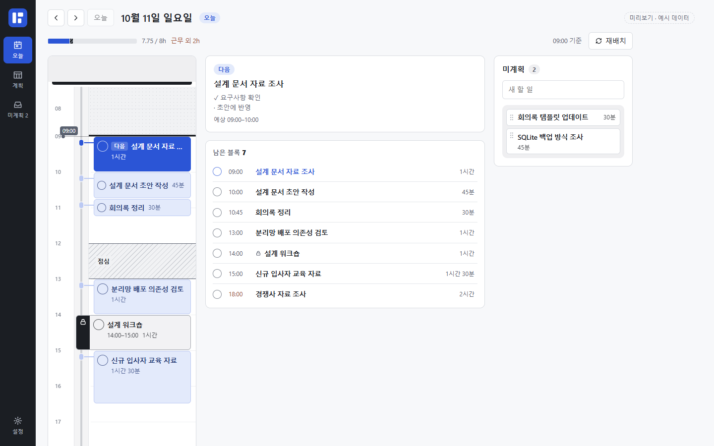

# BLOKKY

**할 일을 시간 블록으로 담고, 끝낸 만큼 오늘을 다시 정리하는 Windows 업무 앱.**

일반 업무는 날짜·순서·분량으로 계획하고, 회의처럼 시각을 지켜야 하는 일만 고정합니다. 오늘 할 일을 끝내면 남은 블록이 지금부터의 공간에 다시 놓입니다. 로그인 없이, 네트워크 연결 없이 로컬에서 사용합니다.



*현재 소스의 브라우저 미리보기. 실제 사용자 기록이 아닌 예시 데이터입니다.*

[사용법](#사용법) · [만든 철학](#만든-철학) · [기술 스택](#기술-스택) · [개발 내용](#개발-내용) · [개발 환경](#개발-환경)

## 만든 철학

### 계획을 유지하는 데 쓰는 주의를 줄이기

하루의 모든 일에 정확한 시작 시각을 정하면, 한 가지 일이 길어질 때마다 시간표를 고쳐야 합니다. BLOKKY는 **오늘 할 일의 양과 순서**를 먼저 정하도록 만듭니다. 시작 시각은 그 순서와 가용 공간으로부터 계산합니다.

| 상태 | 사용자가 정하는 것 | 시간표에서의 동작 |
| --- | --- | --- |
| **미계획** | 해야 할 일과 예상 분량 | 날짜를 정하기 전까지 따로 보관 |
| **유동계획** | 날짜·순서·분량 | 휴식과 고정 일정을 피해 순서대로 배치 |
| **고정계획** | 날짜·시작 시각·분량 | 지정한 시각의 공간을 유지 |

유동 블록은 자동으로 쪼개거나 순서를 바꾸지 않습니다. 들어갈 연속 공간이 부족하면 근무 종료 뒤로 이어 놓고, 점선과 근무 외 분량으로 보여 줍니다.

### 시계가 아니라 행동에 반응하기

오늘의 유동 작업을 완료하거나 **재배치**를 누르면 남은 일이 지금부터 다시 놓입니다. 시간이 흐르거나 앱을 다시 열었다는 이유로 블록이 움직이지 않습니다. 고정 작업은 완료해도 예약 공간을 유지하며, 고정을 풀거나 옮길 때 그 공간이 바뀝니다.

블록의 60분은 **배분한 시간**입니다. 실제 수행시간이나 진행률로 해석하지 않으며, 타이머를 켜고 끄는 절차도 요구하지 않습니다.

### 조작은 직접, 기록은 안전하게

순서는 블록을 옮겨서, 시각은 레일에 걸어서, 분량은 경계를 늘려서 바꿉니다. 작업을 열면 제목과 메모가 먼저 보입니다. 계획을 편집하는 화면과 오늘 할 일을 수행하는 화면의 역할도 나눴습니다.

저장 실패를 성공이나 빈 목록으로 감추지 않습니다. 작성 중인 초안, 휴지통, 로컬 백업을 두고, 종료·복원·업데이트 과정에서도 기록을 보호합니다. 이 설계가 지향하는 것은 계획 관리 부담의 감소이며, 생산성 향상을 측정해 입증했다는 뜻은 아닙니다.

설계의 배경은 [유동형 업무 배분 재설계안](docs/BLOKKY_redesign_intent_and_ux.md), 현재 정책은 [제품 정의](PRODUCT.md)와 [구현 결정](docs/decisions.md)에 기록합니다.

## 사용법

### 1. 생각나는 일을 담기

**미계획** 입력란에 제목을 쓰고 `Enter`를 누릅니다. 새 작업의 기본 분량은 30분이며, 15분 단위로 조절합니다. 제목을 클릭하면 상세 메모와 체크리스트를 작성할 수 있습니다. 체크리스트를 모두 체크해도 작업 자체가 자동 완료되지는 않습니다.

다른 앱에서 일하는 중에는 `Ctrl+Shift+Space`로 **빠른 캡처** 창을 엽니다. `Enter`로 저장하고, `Shift+Enter`로 줄을 바꾸며, `Esc`로 초안을 보존한 채 숨깁니다. 단축키는 설정에서 변경할 수 있습니다.

### 2. 하루에 배분하기

**계획**의 시간표에 미계획 작업을 끌어 놓습니다. 본문에 놓으면 해당 날짜의 유동 작업이 되고, 시간 눈금 옆 **고정 레일**에 맞물리면 시각이 고정됩니다. 고정 블록을 레일에서 떼어 본문에 놓으면 다시 유동 작업이 됩니다.

| 보기 | 용도 |
| --- | --- |
| **일** | 하루를 넓게 펼쳐 블록을 만들고 배치 |
| **주** | 여러 날짜의 시간표를 함께 보고 작업 이동 |
| **2주** | 날짜별 작업 제목을 보고 선택 날짜의 시간표 확인 |
| **월** | 날짜별 작업량을 보고 선택 날짜의 시간표 확인 |

주 보기의 날짜 머리나 2주·월 보기의 선택 날짜 제목을 누르면 **일** 보기로 이동합니다. 일·주 시간표의 빈 곳을 클릭하면 순서 끝에 새 블록을 만들고, 범위를 드래그하면 선택 시각의 고정 블록을 만듭니다.

블록 하단 손잡이로 분량을 바꾸고, 우클릭 메뉴에서 완료·순서 변경·고정/해제·나누기·미계획 이동을 선택합니다. **나누기**는 총 분량을 보존하며 뒤쪽 블록을 메모와 함께 미계획에 둡니다. **하루 비우기**는 작업을 삭제하지 않고 해당 날짜의 블록을 미계획으로 돌립니다.

### 3. 오늘 할 일에 집중하기

**오늘**은 좁은 시간표, **다음** 할 일, 남은 대기열, 미계획을 함께 보여 줍니다. 블록이나 대기열의 제목을 누르면 내용을 편집하고, 완료 체크로 일을 마칩니다. 여러 블록을 `Shift` 또는 `Ctrl`+클릭해 한 번에 완료할 수도 있습니다.

오늘의 유동 작업을 완료하면 남은 블록이 지금부터 다시 배치됩니다. 완료 없이 현재 시각을 기준으로 정리하려면 **재배치**를 누릅니다. 새 블록을 시간표에 만들거나 하루 전체를 편집할 때는 **계획 → 일**을 사용합니다.

지난 미완료는 직접 다른 날짜나 미계획으로 옮깁니다. 자동으로 다음 날에 이월하지 않습니다.

### 4. 근무 리듬과 반복 업무 맞추기

- **설정 → 근무시간**에서 요일별 근무·휴식과 주간 목표를 정합니다. 기본 목표는 40시간·5일이며, 실제 근태가 아닌 예정 근무량입니다.
- 시간표의 근무 외 시간이나 휴식을 클릭하면 그 날짜만의 출퇴근·점심·휴가 예외를 설정할 수 있습니다. 고정 작업과 충돌하는 변경은 영향 작업을 확인하고 동의한 뒤 저장합니다.
- **정기 업무**에 요일·시작 시각·분량을 등록하면 화면에 표시된 오늘 이후 날짜에 작업이 생성됩니다. 충돌한 작업은 같은 날짜의 유동 작업으로 남습니다. 정기 업무를 수정·삭제해도 이미 생성한 작업은 바뀌지 않습니다.
- **테마**는 기본·종이 플래너·톤 레이어·사무 장부의 2×2 미리보기에서 선택합니다.

<details>
<summary>키보드 조작과 앱 종료</summary>

| 조작 | 동작 |
| --- | --- |
| `Ctrl+Shift+Space` | 빠른 캡처 열기 — 기본 단축키 |
| 블록 본문 또는 하단 손잡이에서 `↑` / `↓` | 분량을 15분 단위로 조절 |
| 블록 본문에서 `Alt+↑` / `Alt+↓` | 유동 블록 순서 변경 |
| `Shift+F10` | 포커스한 블록의 메뉴 열기 |

창의 `X`는 기본적으로 트레이에 숨깁니다. 트레이 메뉴의 **종료**로 앱을 끝내거나, 설정에서 창 닫기 동작을 종료로 바꿀 수 있습니다. 종료할 때 본 창과 캡처 창의 입력을 자동 저장하며, 저장에 실패하면 종료를 취소하고 오류를 표시합니다. Windows 자동실행은 설정에서 직접 켭니다.

</details>

## 기록과 복구

업무 기록은 로컬 SQLite에 저장합니다. 기본 위치는 `%LOCALAPPDATA%\com.blokky.desktop` 폴더의 `blokky.sqlite`이며, 실제 경로는 앱 설정에서 확인할 수 있습니다.

| 보호 장치 | 동작 |
| --- | --- |
| **초안** | 입력 중인 내용을 별도로 보존하고, 복원된 편집은 ‘이어서 편집’으로 열기 |
| **휴지통** | 삭제한 작업을 30일간 보관하고 원래 날짜·순서·완료 상태로 복원 |
| **자동 백업** | 시간별 24개, 날짜별 30개를 보존 |
| **지금 백업** | 앱 데이터 폴더의 `backups`에 수동 백업 생성 |
| **복원 전 보호** | 미저장 입력을 먼저 정리하고, 현재 기록 교체 확인 및 안전 백업 후 복원 |

휴지통에서 되살린 고정 작업의 자리가 막혔다면 같은 날짜의 유동 작업으로 복원합니다. 개별 영구 삭제와 휴지통 비우기도 제공합니다.

백업은 **설정 → 백업·복원**의 앱 내부 목록에서 검사하고 복원합니다. 손상된 백업은 오류 이유와 함께 비활성화하며, 현재 DB가 열리지 않아도 보관된 백업으로 복구를 시도할 수 있습니다. 수동 백업과 복원 전 안전 백업은 자동 정리 대상에서 제외합니다.

SQLite 백업에는 작업·휴지통·근무 설정·정기 업무·날짜별 생성 이력이 들어갑니다. 테마·빠른 캡처 단축키·자동실행·창 닫기 옵션은 별도 기기 설정입니다. 임의 파일 가져오기나 외부 경로 내보내기는 제공하지 않으며, 같은 디스크의 백업만으로 디스크 고장까지 대비할 수는 없습니다.

## 기술 스택

| 계층 | 기술 | 맡은 역할 |
| --- | --- | --- |
| 화면 | **React 19 · TypeScript · Vite 7** | 오늘·계획·미계획·설정과 브라우저 미리보기 |
| 직접 조작 | **@dnd-kit/core · motion** | 드래그 감지, 배치 전환과 완료 동작 |
| 디자인 | **CSS 역할 토큰 · 로컬 글꼴** | 네 가지 테마와 공통 색·간격·크기 규칙 |
| 데스크톱 | **Tauri 2 · Rust · WebView2** | Windows 창, 전역 단축키, 트레이, 자동실행 |
| 저장 | **SQLite · rusqlite** | 트랜잭션, 초안, 이관, 백업·복구 |
| 검증 | **Node test runner · Rust tests · 헤드리스 Edge** | 순수 로직, 실제 파일 저장소, 명시적 UI 시나리오 |

React 화면에서 보낸 변경은 Tauri IPC를 거쳐 Rust가 검증하고 SQLite에 기록합니다. SQLite가 업무 데이터의 기준이며, WAL·FULL synchronous, revision 검사, 요청 중복 방지와 복원 전후 요청 구분으로 기록 충돌을 다룹니다. 로그에는 제목·메모를 남기지 않습니다.

## 개발 내용

- **로컬 업무 흐름** — 빠른 캡처부터 미계획·정기 업무·근무시간·날짜 예외까지 연결했습니다. [제품 정의](PRODUCT.md)
- **유동형 배분** — 날짜·순서 중심 계획, 고정 일정 우회, 완료·수동 재배치와 근무 외 넘침 표시를 구현했습니다. [재설계안](docs/BLOKKY_redesign_intent_and_ux.md) · [구현 계획](docs/BLOKKY_redesign_implementation_plan.md)
- **React 화면 전환** — 공통 블록 공간과 편집기를 만들고, 오늘 대시보드와 계획의 일·주·2주·월 보기를 구성했습니다. [React 도입 계획](docs/BLOKKY_react_migration_plan.md)
- **직접 조작 개선** — 블록이 포인터를 따라오도록 하고, 레일 맞물림·길이 조절과 이웃 블록의 이동을 다듬었습니다. [구현 결정](docs/decisions.md)
- **입력과 기록 보호** — 한글 조합 중 명령 방지, 초안 복원, 종료 전 저장, 휴지통, DB 이관·백업 복구를 구현했습니다. [검증 기록](docs/validation.md)
- **화면 품질** — 테마 토큰, 키보드 조작과 포커스 복귀, 좁은 창 배치, 날짜·작업의 글자 대비를 개선했습니다. [디자인 기준](DESIGN.md) · [검증 기록](docs/validation.md)

현재 저장소는 **스키마 5**입니다. v1–v3의 배치 작업은 고정 작업으로 읽고, v4에는 휴지통 정보를 추가해 이관합니다. 이관 직전에 안전 백업을 만들며, 새 스키마를 지원하지 않는 구버전 앱의 접근은 차단합니다.

<details>
<summary>코드 구조</summary>

```text
src/
  app/
    today/ · plan/ · inbox/   화면별 업무 흐름
    space/                   공통 블록 공간과 드래그
    editor/ · settings/      작업 편집과 설정
    store/                   앱 상태, 명령, 초안, 종료 흐름
    capture/ · backups/      빠른 캡처와 백업 화면
  flow.ts                    순서를 지키는 유동 배치 계산
  placement.ts · settings.ts  배치 검증과 근무 규칙
  tokens.css · theme.ts       역할 토큰과 테마
src-tauri/src/
  main.rs                    Windows 통합과 IPC
  db.rs · model.rs           SQLite 저장소와 데이터 규칙
scripts/                     실행·개발 서버·UI 확인 도구
docs/                        설계 결정과 검증 근거
```

</details>

## 개발 환경

Windows에서 **Node.js 22.12+**, Rust, MSVC C++ 빌드 도구, WebView2가 필요합니다.

### 데스크톱 앱 실행

저장소 루트의 PowerShell에서 실행합니다.

```powershell
npm ci
./scripts/run.ps1 dev
```

스크립트는 `.tools/cargo`의 로컬 Rust가 있으면 우선 사용하고, 없으면 시스템 환경을 사용합니다. 개발 서버는 1420부터 가용 포트를 선택해 Tauri에 전달합니다. 이전 개발 앱이 실행 중이면 트레이에서 종료한 뒤 다시 시작합니다.

### 화면만 미리 보기

```powershell
npm run dev
```

터미널에 출력된 로컬 주소를 엽니다. 브라우저에서는 **저장하지 않는 예시 데이터**로 동작하며, 실제 저장·백업 검증은 데스크톱 앱에서 수행합니다.

### 검증과 패키징

```powershell
./scripts/run.ps1 test -NoPause   # 프런트 로직 + Rust 저장소 테스트
npm run build                   # TypeScript 검사 + 프런트 배포 빌드
./scripts/run.ps1 package        # Windows NSIS 설치 파일 생성
```

UI 확인은 개발 서버 실행 후 별도로 수행합니다. `--base`에는 실제 출력된 주소를 지정합니다.

```powershell
node scripts/ui-check.mjs --base http://127.0.0.1:1420
```

이 검사는 헤드리스 Edge의 마우스·키보드 입력을 사용하며 기본 `npm test`에 포함되지 않습니다. 네이티브 디버그 앱은 `BLOKKY_TEST_DATA_DIR`로 시험 데이터 위치를 분리할 수 있습니다. 검증 계층과 비용 기준은 [테스트 정책](docs/test-policy.md)을 참고하세요.

패키징 결과는 `src-tauri/target/release/bundle/nsis/`에 생성됩니다. 설치 파일에는 WebView2 오프라인 설치기가 포함되며 코드 서명은 적용하지 않았습니다. WebView2가 설치된 환경에서는 `src-tauri/target/release/blokky.exe`로도 실행할 수 있습니다. **로컬에 남아 있는 설치 파일이 최신 소스를 반영한다는 뜻은 아닙니다.**

## 현재 범위와 검증 상태

버전은 **0.1.0**, 대상은 **Windows**입니다. 추천·알림·자동 이월·클라우드 동기화·협업·자정을 넘는 블록·복잡한 반복 규칙은 지원하지 않습니다. 계획한 분량을 실제 근태나 수행시간 통계로 기록하지 않습니다.

[검증 기록](docs/validation.md)은 브라우저 UI, 실제 SQLite, 네이티브 앱, 설치 파일의 확인 범위를 구분합니다. 최근 변경에 대해 프런트 테스트·배포 빌드와 일부 Edge 시나리오가 확인되어 있지만, 모든 Windows 환경·물리 입력·스크린리더·최신 설치본 전체의 검증 완료를 의미하지는 않습니다.

처음 수정한다면 [제품 정의](PRODUCT.md)로 동작 범위를 확인하고, [구현 결정](docs/decisions.md)과 [테스트 정책](docs/test-policy.md)을 함께 읽어 주세요.
